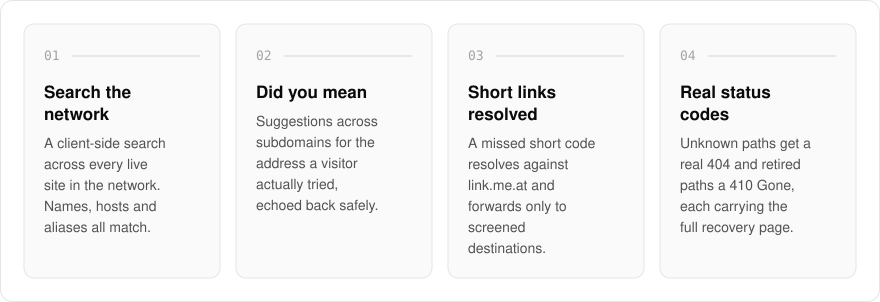
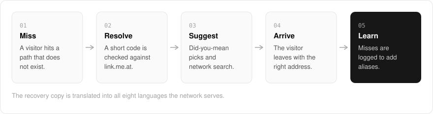

  <picture>
    <source media="(prefers-color-scheme: dark)" srcset=".github/assets/hero-dark.png">
    
  </picture>

<h1 align="center">lost.me.at</h1>

<strong>You lost me at... the lost and found for the *.me.at network.</strong>

  
  
  

  <a href="#features">Features</a> ·
  <a href="#how-it-works">How it works</a> ·
  <a href="#screenshots">Screenshots</a> ·
  <a href="#built-with">Built with</a>

A mistyped address or a dead short link usually ends on a blank "not found" page, and the visitor gives up. I built lost.me.at as the 404 and recovery hub for my `*.me.at` family, so a wrong turn becomes a way back. Bring a mistyped address, a dead short link or a page that moved, and leave with the right one: a searchable directory of every live site in the network, suggestions for where you probably meant to go, and short-link resolution.

  <picture>
    <source media="(prefers-color-scheme: dark)" srcset=".github/assets/overview-dark.svg">
    
  </picture>

## Why lost.me.at

| The usual 404 page | lost.me.at |
| --- | --- |
| A dead end | A recovery page with search across the whole network |
| Ignores the address you typed | Suggests where you probably meant to go, from the address you tried |
| A dead short link stays dead | A missed short code is resolved against link.me.at |
| Nobody learns where people get lost | Misses are logged so aliases and redirects can be added |

## Features

- **Search the network**: a client-side search across every live destination, where names, hosts and aliases all match.
- **"Did you mean" suggestions**: cross-subdomain suggestions for the address a visitor actually tried, echoed back safely.
- **Short-link resolution**: a missed path shaped like a short code is resolved against link.me.at, forwarding only to screened destinations and asking for confirmation otherwise.
- **Real status codes**: unknown paths get a real 404, and retired paths a 410 Gone, both carrying the full recovery page.
- **A miss ledger for the owner**: missed paths are logged so aliases and redirects can be added where people actually get lost.
- **Eight languages**: the recovery copy is translated into every locale the network serves.

## How it works

  <picture>
    <source media="(prefers-color-scheme: dark)" srcset=".github/assets/flow-dark.svg">
    
  </picture>

When a visitor reaches a path that does not exist, the recovery page answers with a real 404 (or a 410 for a retired path) instead of a blank error. If the path looks like a short code it is checked against link.me.at first, and otherwise the page offers did-you-mean suggestions and a search across every live site. Each miss is logged, so the places people get lost can turn into aliases and redirects.

## Screenshots

<table>
  <tr>
    <td width="50%"><picture><source media="(prefers-color-scheme: dark)" srcset=".github/assets/hero-dark.png"></picture> The landing page: search every site in the network by name, host or alias.</td>
    <td width="50%"><picture><source media="(prefers-color-scheme: dark)" srcset=".github/assets/wrong-turn-dark.png"></picture> A wrong turn: a missed path lands on the recovery page with search and suggestions.</td>
  </tr>
</table>

## Built with

  
  
  
  
  
  

- Next.js 16 (App Router), React 19, TypeScript
- Tailwind CSS 4
- next-intl (eight locales)
- Drizzle ORM + Postgres (read side of link.me.at's short-link store)
- Hand-drawn inline SVG illustrations

## Part of the me.at family

lost.me.at is one of my [`*.me.at`](https://me.at) apps. They share one design system, account, and app shell. Development happens in a private monorepo; this repository is the project's public-facing home.

## License

Source-available. See [LICENSE](LICENSE).
