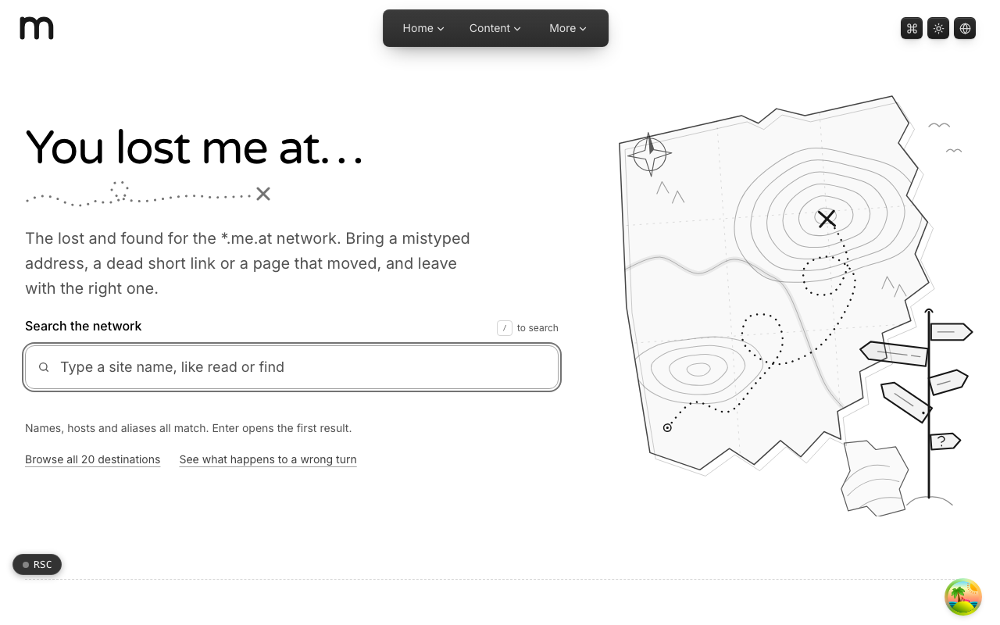
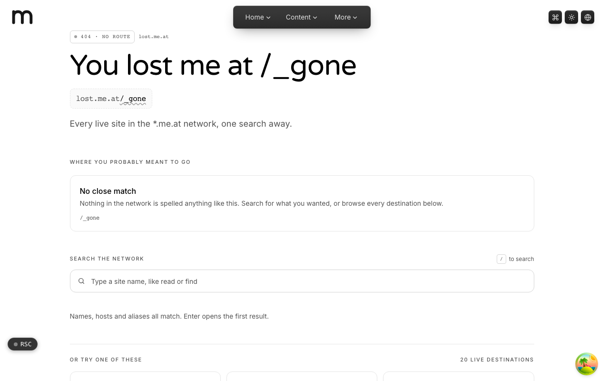

  <picture>
    <source media="(prefers-color-scheme: dark)" srcset=".github/assets/hero-dark.png">
    
  </picture>

# lost.me.at

You lost me at... the lost and found for the `*.me.at` network.

lost.me.at is the 404 and recovery hub for the `*.me.at` family. Bring a mistyped address, a dead short link or a page that moved, and leave with the right one. Instead of a dead end, every unknown path resolves to a helpful recovery page: a searchable directory of every live site in the network, suggestions for where you probably meant to go, and short-link resolution.

## Features

- **Search the network**: a client-side search across every live destination, where names, hosts and aliases all match.
- **"Did you mean" suggestions**: cross-subdomain suggestions for the address a visitor actually tried, echoed back safely.
- **Short-link resolution**: a missed path shaped like a short code is resolved against link.me.at, forwarding only to screened destinations and asking for confirmation otherwise.
- **Real status codes**: unknown paths get a real 404, and retired paths a 410 Gone, both carrying the full recovery page.
- **A miss ledger for the owner**: missed paths are logged so aliases and redirects can be added where people actually get lost.
- **Eight languages**: the recovery copy is translated into every locale the network serves.

## Screenshots

<table>
  <tr>
    <td width="50%"><picture><source media="(prefers-color-scheme: dark)" srcset=".github/assets/wrong-turn-dark.png"></picture> A wrong turn: a missed path lands on the recovery page with search and suggestions.</td>
  </tr>
</table>

## Built with

- Next.js 16 (App Router), React 19, TypeScript
- Tailwind CSS 4
- next-intl (eight locales)
- Drizzle ORM + Postgres (read side of link.me.at's short-link store)
- Hand-drawn inline SVG illustrations

## Part of the me.at family

lost.me.at is one of the [`*.me.at`](https://me.at) apps by Trevor McDougald. They share one design system, account, and app shell. Development happens in a private monorepo; this repository is the project's public-facing home.

## License

See [LICENSE](LICENSE).
